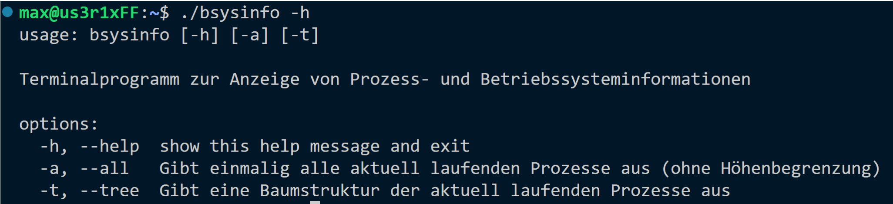
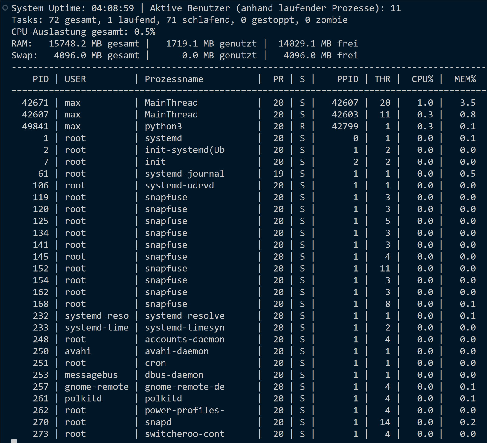
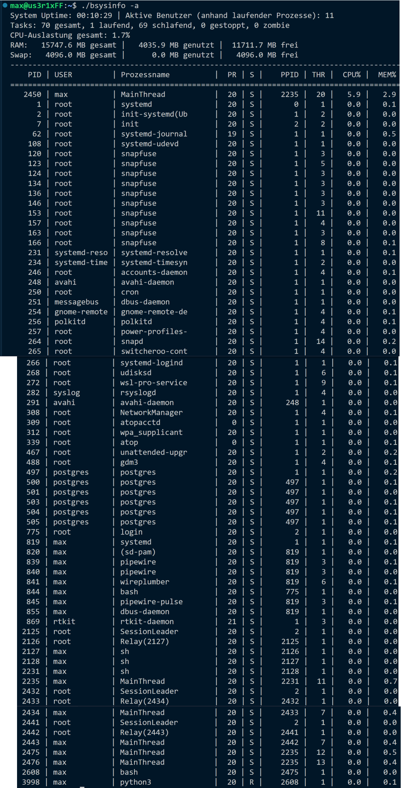
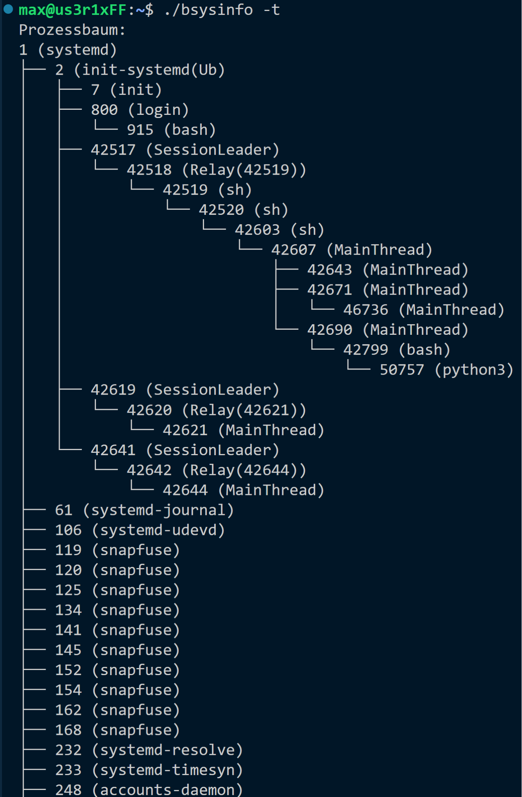

# BSysInfo

Ein Terminalprogramm in Python, das ähnlich wie `top` und `pstree` Prozess- und Systeminformationen anzeigt. Entstanden als Praktikumsaufgabe 3.1 im Fach Betriebssysteme (Sommersemester 2026, Hochschule Albstadt-Sigmaringen).

Alle Daten kommen direkt aus dem `/proc`-Dateisystem. Externe Programme wie `ps`, `top` oder `pstree` werden nicht aufgerufen, und es wird nur die Python-Standardbibliothek verwendet (`os`, `shutil`, `argparse`, `time`, `pwd`).

## Aufruf

```bash
chmod +x bsysinfo
./bsysinfo        # Live-Ansicht, aktualisiert sich alle 3 Sekunden (Strg+C beendet)
./bsysinfo -a     # einmalige Momentaufnahme aller Prozesse
./bsysinfo -t     # Prozessbaum
./bsysinfo -h     # Hilfe
```

Läuft nur unter Linux bzw. WSL, weil `/proc` und das Modul `pwd` gebraucht werden.

## Anzeigen

**Systemübersicht** (Standardansicht und `-a`):

- Uptime und Anzahl aktiver Benutzer (gezählt als unterschiedliche Besitzer laufender Prozesse)
- Tasks gesamt sowie laufend, schlafend, gestoppt und Zombie
- CPU-Auslastung gesamt
- RAM und Swap jeweils gesamt, genutzt und frei

**Prozesstabelle**, absteigend nach CPU-Auslastung sortiert:

| Spalte | Bedeutung |
|---|---|
| PID | Prozess-ID |
| USER | Besitzer des Prozesses |
| Prozessname | Name aus `/proc/[PID]/stat` |
| PR | Priorität |
| S | Status (R, S, D, I, T, Z) |
| PPID | ID des Elternprozesses |
| THR | Anzahl Threads |
| CPU% | CPU-Auslastung des Prozesses |
| MEM% | Anteil am Arbeitsspeicher |

- **Standard:** Die Höhe der Tabelle richtet sich nach der Terminalgröße (`shutil.get_terminal_size()`), die Daten werden alle 3 Sekunden neu eingelesen.
- **`-a`:** Alle Prozesse werden einmalig und ohne Höhenbegrenzung ausgegeben.
- **`-t`:** Baumstruktur der laufenden Prozesse; mit `├──`, `└──` und `│` ist sichtbar, welcher Prozess zu welchem Elternprozess gehört.

## Datenquellen

| Datei | Verwendung |
|---|---|
| `/proc/uptime` | Laufzeit des Systems |
| `/proc/meminfo` | `MemTotal`, `MemFree`, `SwapTotal`, `SwapFree` |
| `/proc/stat` | CPU-Zeiten des Gesamtsystems (Zeile `cpu`) |
| `/proc/[PID]/stat` | Name, Status, PPID, CPU-Zeiten (utime, stime), Priorität, Threads, RSS |
| `/proc/[PID]/status` | UID des Besitzers, die über `pwd` in den Benutzernamen übersetzt wird |

## Umsetzung

**Modus 1 und 2 (Standard und Momentaufnahme):** Zuerst werden die Argumente über `argparse` definiert. Für das Einlesen gibt es eigene Funktionen: `hole_system_laufzeit()` liest `/proc/uptime`, `hole_speicher_info()` wertet `/proc/meminfo` für RAM und Swap aus und `hole_globale_cpu_zeiten()` holt die CPU-Zeiten aus `/proc/stat`. Für die Prozesstabelle geht das Programm alle numerischen Ordner in `/proc` durch, liest aus `/proc/[PID]/stat` die Prozessdaten und ermittelt über `status` und `pwd` den Besitzer. Weil die CPU-Last eine Differenz über die Zeit ist, wird beim Start eine erste Messung gemacht und nach einer kurzen Pause (0,5 s) eine zweite. Im Standardmodus läuft das Ganze in einer Schleife mit 3 Sekunden Abstand; bei `-a` entfallen Schleife und Höhenlimit.

**Modus 3 (Prozessbaum):** Basis ist die bereits eingelesene Prozessliste. `ausgabe_prozess_baum()` baut ein Dictionary auf, das jeder PPID die Liste ihrer Kind-PIDs zuordnet. Prozesse, deren Elternprozess nicht in der Liste vorkommt (z. B. PID 1 mit PPID 0), sind die Wurzeln. Eine rekursive Funktion gibt den Baum von den Wurzeln aus und wählt die Zeichen danach, ob ein Prozess das letzte Kind auf seiner Ebene ist.

## Screenshots

Hilfe (`-h`):



Standardansicht:



Momentaufnahme (`-a`):



Prozessbaum (`-t`), Fortsetzung in [docs/baum_t_2.png](docs/baum_t_2.png):



## Fragen aus der Aufgabenstellung

**1. Wie wird die prozentuale CPU-Auslastung berechnet?**

Über das Delta-Prinzip. Der Kernel zählt in `/proc/stat` (für das ganze System) und in `/proc/[PID]/stat` (pro Prozess) fortlaufend, wie viele Clock-Ticks (Einheit `USER_HZ`, meist 1/100 s) seit dem Systemstart in welchem Zustand verbracht wurden. Ein einzelner Wert sagt deshalb nichts über die aktuelle Last aus. Man misst zweimal und vergleicht die Differenzen:

```
Leerlauf     = idle + iowait
Beschäftigt  = user + nice + system + irq + softirq + steal
CPU% gesamt  = (ΔGesamt − ΔLeerlauf) / ΔGesamt · 100
CPU% Prozess = Δ(utime + stime) / ΔGesamt · 100 · Anzahl Kerne
```

**2. Was ist der Unterschied zwischen MemAvailable und MemFree?**

- `MemFree` ist Speicher, in dem gar nichts steht.
- `MemAvailable` ist ein geschätzter Wert dafür, wie viel RAM neuen Prozessen zur Verfügung steht, ohne dass ausgelagert werden muss. Er enthält neben dem freien Speicher auch Caches, die der Kernel bei Bedarf freigeben kann, und ist deshalb meist deutlich größer.

BSysInfo rechnet „genutzt“ als `MemTotal − MemFree`, Caches zählen dort also als genutzt.

**3. Was beschreibt der Wert RSS?**

Die Resident Set Size ist der Teil des Speichers eines Prozesses, der tatsächlich physisch im RAM liegt (nicht ausgelagert). In `/proc/[PID]/stat` steht sie in Seiten; mal Seitengröße ergibt sich der Wert in Byte, daraus berechnet BSysInfo MEM%.

**4. Welche Prozesszustände können auftreten?**

| Zustand | Bedeutung |
|---|---|
| R (Running) | Der Prozess läuft gerade auf einem CPU-Kern oder wartet bereit in der Run-Queue, bis ein Kern frei wird. |
| S (Interruptible Sleep) | Der Prozess wartet auf ein Ereignis, z. B. eine Eingabe im Terminal oder ein Netzwerkpaket. Er ist unterbrechbar und kann durch Signale geweckt werden. |
| D (Uninterruptible Sleep) | Der Prozess wartet, meist auf I/O, und kann dabei nicht durch Signale unterbrochen werden. Bleibt ein Prozess lange in diesem Zustand, kann das auf ein Problem mit Hardware oder Treiber hindeuten. |
| Z (Zombie) | Der Prozess ist beendet, hat aber noch einen Eintrag in der Prozesstabelle, bis der Elternprozess seinen Exit-Status abholt. |
| T (Stopped) | Der Prozess wurde durch ein Signal angehalten, z. B. mit `Strg+Z` (Job Control). Wird er von einem Debugger angehalten, zeigt Linux `t` (tracing stop). |
| I (Idle) | Untätiger Kernel-Thread. BSysInfo zählt ihn zu den schlafenden Tasks. |
